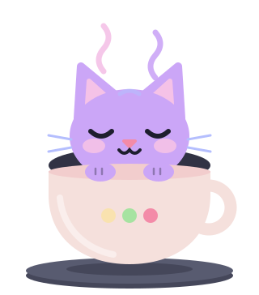
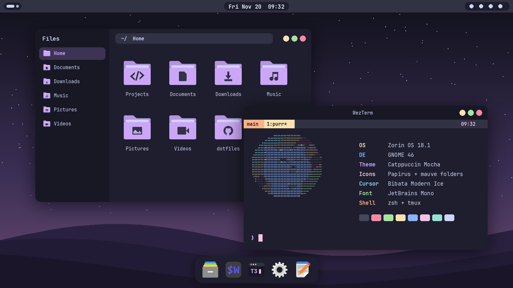
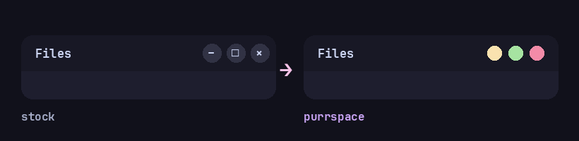
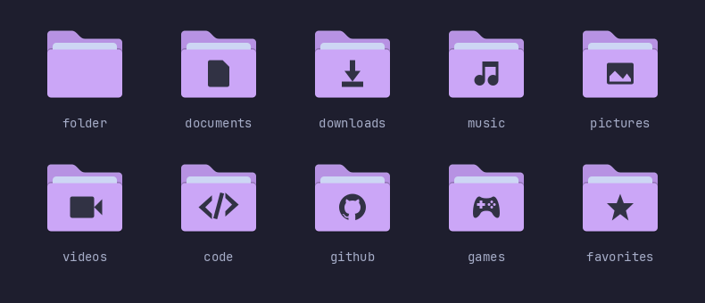

<div align="center">
  

  # purrspace

  **Catppuccin Mocha for GNOME, purring on any laptop.**

  <p>
    
    
    
    
  </p>

  New laptop, same purr. One command and the whole cozy desktop comes back.
</div>

---

<div align="center">
  
  <br />
  <sub>An illustration drawn from the theme itself: the colors, folders, icons and cat are the real ones.</sub>
</div>

## What you get

| | |
|---|---|
| **Traffic lights** | Pastel minimize, maximize and close dots on the right, in GTK3, GTK4, Chrome, VS Code and Slack. |
| **Mocha everywhere** | Windows, top bar, menus, terminal, editor, Spotify, Obsidian, Telegram and lazygit share one palette. |
| **A calmer top bar** | Solid `surface0` instead of whatever color the wallpaper has, a JetBrains Mono clock, stock status icons. |
| **Mauve folders** | The full Papirus icon theme with Catppuccin Mocha folders. |
| **A terminal that purrs** | WezTerm + tmux in Mocha, and fastfetch with a cat made of characters. |
| **A tidy app grid** | Apps sorted into folders (AI, Dev, Internet, Office, Media, Games, System, Utilities) and a short dock. |
| **Gentle extras** | Blur, clipboard history and caffeine, plus Zorin's magic lamp and desktop cube. |

<table align="center">
  <tr>
    <td align="center"><br /><sub>The buttons, before and after</sub></td>
    <td align="center"><br /><sub>Papirus with Catppuccin folders</sub></td>
  </tr>
</table>

## Install

```bash
git clone https://github.com/BrisaTielly/purrspace ~/purrspace
cd ~/purrspace
./install.sh
```

No password needed: everything goes into your home folder. Before touching anything it
backs up your setup to `~/.config/purrspace-backup/<date>/`, and it is safe to run again.
If a step fails, the others keep going and the end of the run tells you what to retry.

Run only some steps:

```bash
./install.sh --list            # show the steps
./install.sh theme icons       # run just those
```

| Step | What it does |
|---|---|
| `backup` | Saves your GNOME settings (`dconf dump`). |
| `fonts` | JetBrains Mono Nerd Font. |
| `cursor` | Bibata Modern Ice. |
| `theme` | Window and top bar theme, traffic lights, buttons on the right. |
| `icons` | Papirus-Dark with mauve folders; stock icons in the top bar. |
| `extensions` | User Themes, Blur my Shell, Clipboard Indicator, Caffeine. |
| `wallpaper` | Downloads and sets *purple-horizon*. |
| `terminal` | WezTerm, tmux, fastfetch, Neovim, lazygit and fzf. |
| `flatpak` | Theme, traffic lights and cursor for Flatpak apps; one title bar for VS Code and Slack. |
| `spotify` | Moves Spotify to a user Flatpak and applies Spicetify Catppuccin. |
| `obsidian` | Catppuccin theme in every vault. |
| `apps` | App grid folders, dock favorites and the T3 icon. |

### The last few touches

Some apps keep their settings out of reach, so these stay manual:

1. **Log out and back in.** On Wayland, new extensions only load after a new session.
2. **Chrome:** Settings → Appearance → Mode → **GTK**, then `chrome://restart`. GTK mode is what puts the dots in the tab strip.
3. **VS Code:** install *Catppuccin for VSCode* (and *Catppuccin Icons*, if you like).
4. **Telegram:** open <https://t.me/addtheme/ctp_mocha>.
5. **Slack:** Preferences → Appearance → custom theme: sidebar `#181825`, selected `#cba6f7`, highlights `#f5c2e7`, text `#cdd6f4`.

Spotify updates can wash the theme away. Bring it back with `spicetify backup apply`.

## The palette

<p>
  
  
  
  
  
  
  
  
  
</p>

## Make it yours

| To change | Edit |
|---|---|
| Traffic lights in GTK4 apps (Files, Settings…) | `files/gtk-4.0/gtk.css` |
| Traffic lights in GTK3 apps and in Chrome, VS Code, Slack | `files/gtk-3.0/gtk.css` |
| Top bar color and clock font | the *purrspace tweaks* block at the end of `files/themes/Catppuccin-GnomeTheme/gnome-shell/gnome-shell.css` |
| App grid folders and dock favorites | `scripts/helpers.py` (`FOLDERS`, `favorites`) |
| Terminal | `files/wezterm.lua`, `files/tmux.conf`, `files/fastfetch/` |
| README images | `python3 scripts/make-readme-assets.py` redraws `docs/assets/` |

<details>
  <summary><strong>Lessons already paid for</strong></summary>

  <br />

  The installer works around every one of these. They are here for the day something breaks again.

  - **Changed the CSS and Files didn't notice.** Nautilus keeps running after its window closes. `nautilus -q`, then open it again.
  - **No traffic lights in Flatpak Chrome, Slack or VS Code.** Inside a Flatpak, GTK reads `~/.var/app/<app>/config/gtk-3.0/gtk.css`, not `~/.config/gtk-3.0/`. The `flatpak` step links them; after installing a new Flatpak app, run `./install.sh flatpak`.
  - **Huge dots in Chrome and VS Code.** They draw the button at a fixed size and ignore `min-width`, so in GTK3 the dot is a `radial-gradient` at 68% of the button.
  - **The theme kept winning.** Its selectors stack several `:not(...)`; the traffic-light rules start with `window ...` and repeat them to weigh more.
  - **A top bar the color of the wallpaper.** The theme makes it fully transparent; the tweak gives it `#313244` at 85%.
  - **The clock font wouldn't change.** The GNOME top bar ignored a quoted `font-family` with fallbacks. A plain `font-family: JetBrains Mono;` worked.
  - **Reload the top bar theme without logging out:** set `org.gnome.shell.extensions.user-theme name` to an empty string and back.
  - **Two strips on top of VS Code and Slack.** With the system title bar (the one with dots) the menu becomes a second strip, so it is hidden and comes back with <kbd>Alt</kbd>. In Slack that is `autoHideMenuBar` in `storage/root-state.json`, edited while Slack is fully closed (it hides in the tray).
  - **Chrome went light in GTK mode.** The Flatpak needed `gtk-application-prefer-dark-theme=1` in its own `settings.ini`.
  - **Grey, generic folders.** The Papirus install was incomplete (16 px only); the installer brings the whole theme.
  - **Spicetify won't patch the Snap Spotify.** Snap files are read-only; it has to be a `--user` Flatpak.
  - **Spotify "stuck" loading after theming.** The first launch is just slow. Wait.
  - **A different cursor in WezTerm.** On Wayland it doesn't inherit GNOME's: `config.xcursor_theme` in `wezterm.lua`.
  - **Installed an extension and it isn't there.** On Wayland it loads after logging out and back in.
</details>

## Built on

- The purrspace cat and the README illustrations are drawn in code by `scripts/make-readme-assets.py`
- [neuromask/catppuccin-linux-theme](https://github.com/neuromask/catppuccin-linux-theme) (MIT) for the GNOME Shell and GTK theme, with purrspace tweaks
- [Catppuccin](https://catppuccin.com/ports/) ports: Papirus folders, Spicetify, Obsidian, lazygit, fzf, Neovim
- [Papirus](https://github.com/PapirusDevelopmentTeam/papirus-icon-theme) icons and the [Bibata](https://github.com/ful1e5/Bibata_Cursor) cursor
- Wallpaper from [orangci/walls-catppuccin-mocha](https://github.com/orangci/walls-catppuccin-mocha), downloaded at install time

---

<div align="center">
  <strong>Made in Mocha, one tiny dot at a time.</strong>
  <br />
  <sub>The cat keeps the cushion warm for your next laptop.</sub>
</div>
